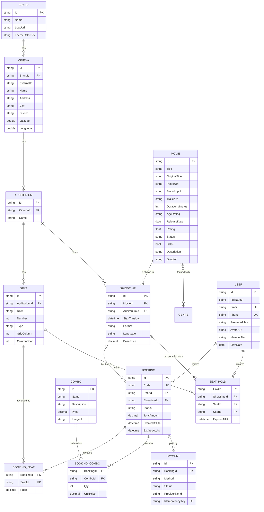

# BACKEND_NOTES – CineBook (CINEMA_CENTER)

Tài liệu dành cho **backend/database team**. Frontend (WPF) chỉ giao tiếp qua các interface trong
`src/CineBook.App/Services/Interfaces/Interfaces.cs`. Hiện tất cả đang dùng **Mock service** (dữ liệu cứng).

Cách tìm nhanh trong Visual Studio: `View → Task List`, thêm 3 token `TODO-BACKEND`, `NOTE-DB`, `WARNING-BACKEND`
(*Tools → Options → Environment → Task List → Tokens*). Hoặc tìm toàn solution theo 3 chuỗi đó.

---

## 1. Sơ đồ quan hệ (gợi ý)



Index/ràng buộc quan trọng (`NOTE-DB`):

| Bảng | Ràng buộc |
|---|---|
| `Seat` | unique `(AuditoriumId, Row, Number)` |
| `BookingSeat` / `SeatHold` | unique `(ShowtimeId, SeatId)` trên ghế đang có hiệu lực → chống 2 người cùng giữ 1 ghế |
| `Showtime` | index `(MovieId, StartTimeUtc)`, `(AuditoriumId, StartTimeUtc)`; không cho trùng giờ trong cùng phòng |
| `Cinema` | index `(City, BrandId)`; index không gian trên `(Latitude, Longitude)` (hoặc cột `geography`) |
| `Movie` | full-text index trên `Title`, `OriginalTitle` |
| `User` | unique `Email`, unique `Phone` |
| `Payment` | unique `IdempotencyKey` |

Quy ước chung:
- Thời gian lưu **UTC**, hiển thị giờ Việt Nam (UTC+7). Frontend gửi/nhận ISO‑8601 có offset.
- Ảnh (poster, backdrop, logo, ảnh combo) chỉ lưu **URL (CDN)**, không lưu binary trong DB.
- Đa nhãn hiệu: Id đồng bộ từ hãng ngoài = `BrandId + ExternalId`. Mỗi hãng có API riêng → dùng **Adapter pattern**
  (`ICinemaProvider` cho CGV, Lotte, BHD, Cinestar...) rồi đồng bộ về DB chung.

---

## 2. Danh sách endpoint

Tất cả trả JSON, `camelCase`. Lỗi chung: `401` (chưa/hết hạn đăng nhập), `500` (lỗi server). DTO khớp `Models/Entities.cs`.

| # | Interface.Method | Endpoint gợi ý | Input | Output | Lỗi riêng |
|---|---|---|---|---|---|
| 1 | `IMovieService.GetNowShowingAsync` | `GET /api/movies?status=NowShowing` | – | `Movie[]` | – |
| 2 | `IMovieService.GetComingSoonAsync` | `GET /api/movies?status=ComingSoon` | – | `Movie[]` | – |
| 3 | `IMovieService.GetHotAsync` | `GET /api/movies/hot` | – | `Movie[]` | – |
| 4 | `IMovieService.GetByIdAsync` | `GET /api/movies/{id}` | `id` | `Movie` | `404` |
| 5 | `IMovieService.SearchAsync` | `GET /api/movies/search?q=` | `q` | `Movie[]` | – |
| 6 | `IMovieService.GetByGenreAsync` | `GET /api/movies?genre=&status=&format=&sort=&page=&pageSize=` | `MovieQuery` | `PagedResult<Movie>` | `400` tham số sai |
| 7 | `IMovieService.GetGenresAsync` | `GET /api/genres` | – | `string[]` | – |
| 8 | `ICinemaService.GetBrandsAsync` | `GET /api/brands` | – | `Brand[]` | – |
| 9 | `ICinemaService.GetCinemasAsync` | `GET /api/cinemas?brandId=&city=&district=` | `CinemaFilter` | `Cinema[]` | – |
| 10 | `ICinemaService.GetNearbyAsync` | `GET /api/cinemas/nearby?lat=&lng=&radiusKm=` | toạ độ | `Cinema[]` (có `distanceKm`, tăng dần) | `400` |
| 11 | `ICinemaService.GetMoviesAtCinemaAsync` | `GET /api/cinemas/{id}/movies` | `id` | `Movie[]` | `404` |
| 12 | `IShowtimeService.GetShowtimesAsync` | `GET /api/showtimes?movieId=&cinemaId=&date=` | `date` = ngày giờ VN | `Showtime[]` | – |
| 13 | `IShowtimeService.GetByIdAsync` | `GET /api/showtimes/{id}` | `id` | `Showtime` | `404` |
| 14 | `ISeatService.GetSeatMapAsync` | `GET /api/showtimes/{id}/seats` | `id` | `SeatMap` | `404` |
| 15 | `ISeatService.HoldSeatsAsync` | `POST /api/showtimes/{id}/holds` | `{ "seatIds": [] }` | `SeatHold` | `409` ghế đã bị giữ/đặt, `422` vi phạm rule |
| 16 | `ISeatService.ReleaseSeatsAsync` | `DELETE /api/holds/{holdId}` | `holdId` | `204` | `404` |
| 17 | `IAuthService.SignInAsync` | `POST /api/auth/sign-in` | `{identity, password}` | `{accessToken, refreshToken, user}` | `401`, `423` |
| 18 | `IAuthService.SignUpAsync` | `POST /api/auth/sign-up` | `SignUpRequest` | `{accessToken, refreshToken, user}` | `409` trùng email/SĐT, `422` |
| 19 | `IAuthService.SignOutAsync` | `POST /api/auth/sign-out` | refresh token | `204` | – |
| 20 | `IBookingService.GetCombosAsync` | `GET /api/combos` | – | `Combo[]` | – |
| 21 | `IBookingService.CreateBookingAsync` | `POST /api/bookings` (header `Idempotency-Key`) | `CreateBookingRequest` | `Booking` (Pending) | `409` hold hết hạn, `422` |
| 22 | `IBookingService.ConfirmPaymentAsync` | `POST /api/bookings/{id}/pay` | `{ "method": "Momo" }` | `{paymentUrl}` → sau IPN: `PaymentResult` | `402`, `409` |
| 23 | `IBookingService.GetMyTicketsAsync` | `GET /api/me/bookings` | token | `Booking[]` | `401` |
| 24 | (Home/Detail) nhắc phim | `POST /api/me/reminders` | `{ "movieId": "" }` | `204` | `401` |
| 25 | (IPN cổng thanh toán) | `POST /api/payments/{provider}/ipn` | chữ ký cổng | `200` | `400` sai chữ ký |

### Mẫu JSON

`GET /api/movies/m01` → `Movie`
```json
{
  "id": "m01", "title": "Bóng Đêm Thành Phố", "originalTitle": "City of Shadows",
  "posterUrl": "https://cdn.example.com/posters/m01.jpg", "backdropUrl": "https://cdn.example.com/backdrops/m01.jpg",
  "trailerUrl": "https://youtu.be/xxxx", "genres": ["Hành động", "Hình sự"], "durationMinutes": 128,
  "ageRating": "T16", "releaseDate": "2026-10-27", "rating": 8.1, "status": "NowShowing", "isHot": true,
  "description": "...", "director": "Trần Minh Khải", "cast": ["Lâm Vỹ", "Ngọc Hân"]
}
```

`GET /api/cinemas/nearby?lat=10.77&lng=106.70&radiusKm=40` → `Cinema[]`
```json
[{ "id": "cgv-1", "brandId": "cgv", "name": "CGV Vincom Đồng Khởi", "address": "72 Lê Thánh Tôn, Bến Nghé",
   "city": "TP.HCM", "district": "Quận 1", "latitude": 10.7780, "longitude": 106.7026, "distanceKm": 0.2,
   "brand": { "id": "cgv", "name": "CGV", "logoUrl": "", "themeColorHex": "#C8102E" } }]
```

`GET /api/showtimes?movieId=m01&cinemaId=cgv-1&date=2026-11-16` → `Showtime[]`
```json
[{ "id": "st-9f3", "movieId": "m01", "cinemaId": "cgv-1", "auditoriumId": "cgv-1-r2", "auditoriumName": "Phòng 2",
   "startTime": "2026-11-16T19:00:00+07:00", "format": "FourDX", "language": "Subtitled", "basePrice": 95000 }]
```

`GET /api/showtimes/st-9f3/seats` → `SeatMap` (ghế đôi `columnSpan = 2`; cột bị bỏ trống = lối đi)
```json
{ "showtimeId": "st-9f3", "auditoriumName": "Phòng 2", "totalColumns": 15,
  "rows": [{ "label": "F", "seats": [
    { "id": "cgv-1-r2-F2", "row": "F", "number": 2, "type": "Vip", "status": "Available", "price": 120000, "gridColumn": 2, "columnSpan": 1 } ] }] }
```

`POST /api/showtimes/st-9f3/holds` → `SeatHold`
```json
// request
{ "seatIds": ["cgv-1-r2-F6", "cgv-1-r2-E3"] }
// response 200
{ "holdId": "7c1e...", "expiresAt": "2026-11-16T12:10:00Z" }
// response 409
{ "error": "SEAT_TAKEN", "seatIds": ["cgv-1-r2-F6"] }
```

`POST /api/bookings` → `Booking`
```json
// request
{ "showtimeId": "st-9f3", "holdId": "7c1e...", "seatIds": ["cgv-1-r2-F6"], "combos": { "cb1": 1 } }
// response
{ "id": "b-001", "code": "CB310323", "movieTitle": "Bóng Đêm Thành Phố", "cinemaName": "CGV Vincom Đồng Khởi",
  "auditoriumName": "Phòng 2", "startTime": "2026-11-16T19:00:00+07:00", "seatLabels": ["F6"],
  "totalAmount": 199000, "status": "Pending" }
```

`POST /api/auth/sign-in`
```json
// request
{ "identity": "an@example.com", "password": "••••••••" }
// response
{ "accessToken": "jwt...", "refreshToken": "opaque...", "user": { "id": "u1", "fullName": "Nguyễn Văn An",
  "email": "an@example.com", "phone": "0900000000", "avatarUrl": "", "memberTier": "Silver" } }
```

---

## 3. Enum và giá trị

Frontend dùng tên enum dạng chuỗi PascalCase (cấu hình `JsonStringEnumConverter`).

| Enum | Giá trị |
|---|---|
| `MovieStatus` | `NowShowing`, `ComingSoon` |
| `AgeRating` | `P`, `K`, `T13`, `T16`, `T18` |
| `MovieFormat` | `TwoD` (2D), `ThreeD` (3D), `IMAX`, `FourDX` (4DX) |
| `SubtitleLanguage` | `Subtitled` (Phụ đề), `Dubbed` (Lồng tiếng) |
| `SeatType` | `Standard`, `Vip`, `Couple` |
| `SeatStatus` | `Available`, `Selected` *(chỉ client)*, `Booked`, `Holding`, `Unavailable` |
| `MemberTier` | `Standard`, `Silver`, `Gold`, `Platinum` |
| `BookingStatus` | `Pending`, `Paid`, `Failed`, `Expired`, `Refunded` |
| `PaymentMethod` | `Momo`, `ZaloPay`, `VnPay`, `Card` |
| `MovieSort` | `Newest`, `Rating` |

Server **không bao giờ** trả `Selected` (đó là trạng thái cục bộ của người đang thao tác).

---

## 4. Danh sách `WARNING-BACKEND` (server không được tin client)

| # | Nội dung | Vị trí |
|---|---|---|
| 1 | Id đồng bộ từ rạp ngoài = `BrandId + ExternalId`; Adapter `ICinemaProvider` cho từng hãng | `Models/Entities.cs:4` |
| 2 | Kiểm tra không trùng giờ chiếu trong cùng phòng | `Models/Entities.cs:68` |
| 3 | Giá ghế ở client chỉ để hiển thị; server tính lại | `Models/Entities.cs:94` |
| 4 | Mọi luật validate form phía client phải validate lại ở server | `Helpers/ValidationRules.cs:7` |
| 5 | Race condition 2 người cùng chọn 1 ghế → transaction + unique constraint / optimistic concurrency | `Services/Interfaces/Interfaces.cs:54` |
| 6 | TTL giữ ghế 10 phút + job dọn hold hết hạn; gợi ý SignalR để đẩy trạng thái ghế realtime | `Services/Interfaces/Interfaces.cs:55` |
| 7 | Validate lại tối đa 8 ghế/lần và rule không để trống 1 ghế lẻ | `Services/Interfaces/Interfaces.cs:56` |
| 8 | Mật khẩu chỉ hash ở server (Argon2/BCrypt); client lưu token bằng DPAPI, dùng refresh token | `Services/Interfaces/Interfaces.cs:68` |
| 9 | Giá vé tính lại ở server (loại ghế, định dạng, ngày thường/lễ, hạng thành viên) | `Services/Interfaces/Interfaces.cs:83` |
| 10 | `Idempotency-Key` khi tạo booking | `Services/Interfaces/Interfaces.cs:84` |
| 11 | Trạng thái đơn chỉ đổi theo IPN đã xác thực chữ ký | `Services/Interfaces/Interfaces.cs:88` |
| 12 | Tổng tiền hiển thị ở wizard chỉ để tham khảo | `ViewModels/BookingViewModel.cs:14` |
| 13 | Giới hạn 8 ghế phải kiểm tra lại ở server | `ViewModels/BookingViewModel.cs:228` |
| 14 | Rule ghế trống lẻ bắt buộc kiểm tra lại khi giữ ghế | `ViewModels/BookingViewModel.cs:240` |
| 15 | Giữ ghế trùng → trả `409`, UI tải lại sơ đồ ghế | `ViewModels/BookingViewModel.cs:270` |
| 16 | Tính lại giá + `Idempotency-Key` khi tạo booking | `ViewModels/BookingViewModel.cs:352` |
| 17 | `Paid` chỉ do IPN cổng thanh toán đặt | `ViewModels/BookingViewModel.cs:358` |

> Số dòng có thể lệch khi code thay đổi; tìm lại bằng chuỗi `WARNING-BACKEND`.

Các yêu cầu khác (ghi cả trong comment):
- **Giữ ghế**: hold có TTL 10 phút, unique `(ShowtimeId, SeatId)`; frontend gọi hold khi bấm "Giữ ghế & tiếp tục" ở bước ②,
  nhả khi rời trang (`DELETE /api/holds/{id}`). Frontend đếm ngược theo `expiresAt` server trả về.
- **Vị trí**: tính khoảng cách ở server (Haversine hoặc `geography`), có index không gian.
- **Thanh toán**: callback/IPN từ cổng, trạng thái đơn `Pending → Paid | Failed | Expired → Refunded`.
  Frontend hiện chỉ mô phỏng thành công sau 2 giây.
- **Auth**: access token (JWT) lưu bằng DPAPI (`ProtectedData`) phía client; refresh token xoay vòng; thu hồi khi sign-out.

---

## 5. Thay Mock service bằng service thật (từng bước)

1. Tạo class `ApiMovieService : IMovieService` (ví dụ trong `Services/Api/`). Dùng `HttpClient` + `System.Text.Json`
   (`JsonStringEnumConverter`, `PropertyNamingPolicy = CamelCase`). DTO dùng lại `Models/Entities.cs` (hoặc map sang DTO riêng).
2. Với mỗi method, làm theo comment `TODO-BACKEND` ngay trên method trong `Interfaces.cs` (endpoint, input, output, lỗi).
3. Đăng ký `HttpClient` trong `App.xaml.cs → ConfigureServices`:
   ```csharp
   services.AddHttpClient("api", c => c.BaseAddress = new Uri("https://api.example.com/"));
   ```
4. **Đổi đúng 1 dòng đăng ký** (không sửa View/ViewModel):
   ```csharp
   // trước
   services.AddSingleton<IMovieService, MockMovieService>();
   // sau
   services.AddSingleton<IMovieService, ApiMovieService>();
   ```
5. Làm tương tự lần lượt cho `ICinemaService`, `IShowtimeService`, `ISeatService`, `IAuthService`, `IBookingService`, `ILocationService`.
6. Với `IAuthService`: sau khi đăng nhập, lưu token (DPAPI), gắn `Authorization: Bearer` qua `DelegatingHandler`,
   bắn `AuthStateChanged` để Header cập nhật avatar.
7. Với `ISeatService`: nếu cần realtime, thêm SignalR hub và cập nhật `Seat.Status` (xem `SeatItemViewModel.Status`) khi nhận sự kiện.
8. Xoá dòng đăng ký Mock tương ứng. Giữ `Services/Mock/` để dùng cho demo/test UI nếu muốn.
9. Xử lý lỗi: frontend đã có trạng thái Loading/Empty/Error + nút "Thử lại" và toast; chỉ cần **ném exception có `Message` tiếng Việt dễ hiểu**.
